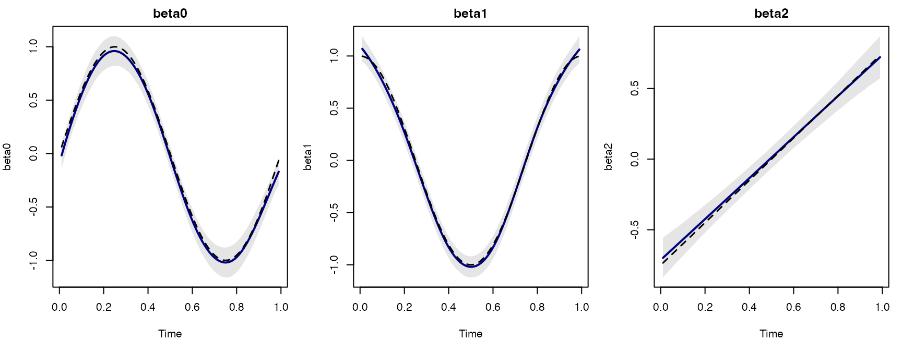
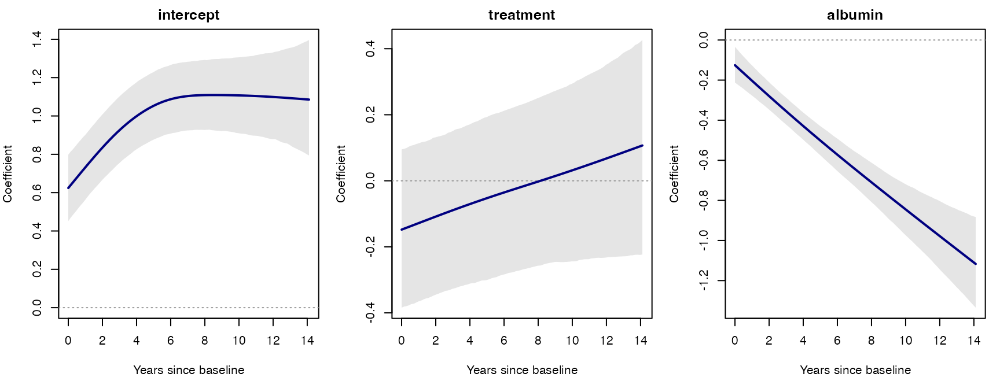

# Getting Started with TDMM

TDMM fits Bayesian time-dynamic mixed-effects models with coefficient
functions that vary over time and subject-specific random intercepts.
Gaussian, Bernoulli, and Poisson responses are supported. Subjects may
have different observation times and visit counts. Numeric covariates
can be constant within subject or change at each visit. The default is
eight cubic B-spline basis functions (degree 3, order 4) with a
second-order coefficient-difference penalty. Install
[JAGS](https://mcmc-jags.sourceforge.io/) before fitting.

This page accompanies the package’s [Getting Started
vignette](https://github.com/esrakurum/Bayesian-TDMM/blob/main/vignettes/getting-started.Rnw).

## Data and fitting

Provide one row per observed subject and visit, with columns for subject
ID, numeric time, response, and covariates. The order of `x.var`
determines the coefficient labels: `beta1` multiplies the first
covariate, `beta2` the second, and so on.

``` r
library(TDMM)
fit <- tdmm(long_data, family = "gaussian",
            subject.var = "id", time.var = "time", y.var = "y",
            x.var = c("baseline", "changing"), n_basis = 8,
            control = tdmm_control(chains = 3, iterations = 4000,
                                   burn_in = 1500, thin = 2,
                                   adapt = 2000, seed = 77181),
            priors = tdmm.priors("gaussian"))
summary(fit)
plot(fit)
plot.trace.tdmm(fit, c("sigma.b", "sigma2.e", "tau.alpha[1]"))
```

Here `baseline` should be repeated within subject and `changing` may
vary by visit. TDMM handles the subject indexing and spline
construction. The Gaussian coefficient curves are on the response scale;
Bernoulli coefficients are on the log-odds scale and Poisson
coefficients on the log-mean scale. Inspect trace plots, R-hat,
effective sample size, and credible bands before interpretation.

## Coefficient-function recovery

The figure illustrates recovery from simulated data with known
coefficient functions. Solid lines show posterior means, dashed lines
the truth, and shaded regions pointwise 95% credible bands. The
[Gaussian
example](https://esrakurum.github.io/Bayesian-TDMM/articles/gaussian.md)
gives the fitting code. The Bernoulli and Poisson examples show the same
workflow for binary and count outcomes.



## PBC2 real-data application

The [PBC2
application](https://esrakurum.github.io/Bayesian-TDMM/articles/pbc2.md)
uses the `pbc2` dataset from JMbayes2: 1,945 observations from 312
subjects, with 1–16 visits. The response is log serum bilirubin;
predictors are a baseline treatment indicator and longitudinal albumin.
Albumin is centered at its overall *observation-level* mean,
3.3898868894601542 g/dL. Thus the intercept represents the modeled
placebo trajectory at that albumin level and random intercept zero.

The treatment 95% credible interval includes zero throughout the common
evaluation grid. The albumin coefficient is negative, with its band
below zero on that grid. These are conditional associations, and the
treatment curve does not establish a causal effect. Late follow-up is
sparse, so small tail fluctuations should not be read as precise
clinical changes.



## Using your own data

Choose `family = "gaussian"`, `"bernoulli"`, or `"poisson"` and supply
the intended covariates in `x.var` order. The data checks reject missing
analysis values; decide how to handle missingness before fitting.
Varying `n_basis` is a useful sensitivity check; scientifically
important smoothing or variance priors can also be examined using
`tdmm.priors()`. For independent chains on macOS or Linux, select
parallel execution through `tdmm_control(parallel = TRUE, cores = 2,
...)`.
